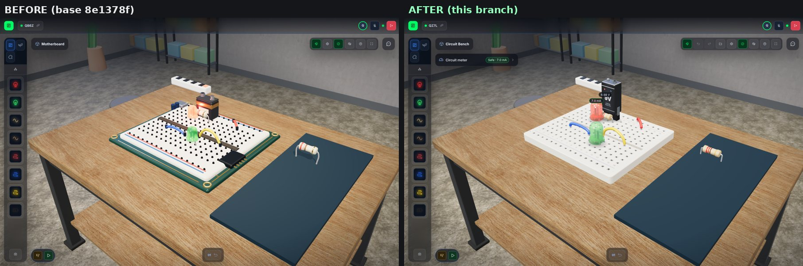
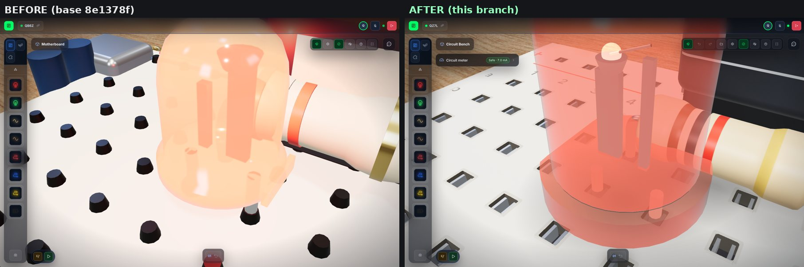
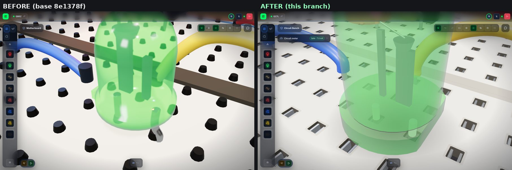
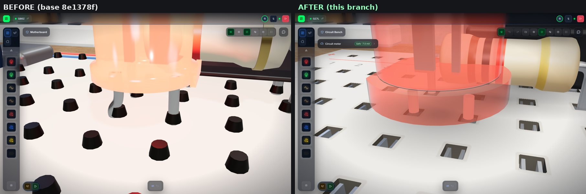
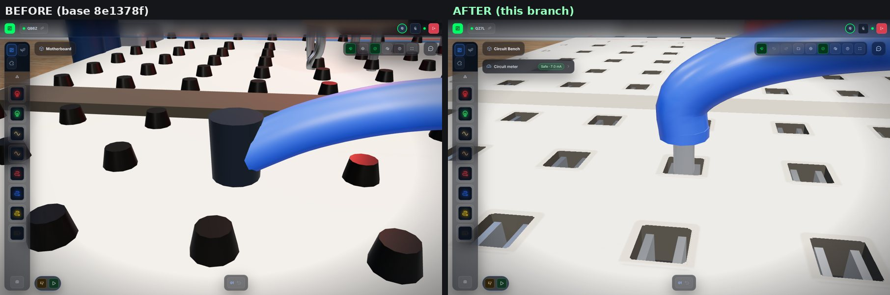
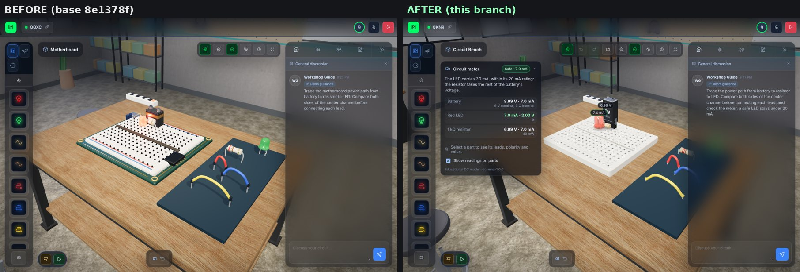
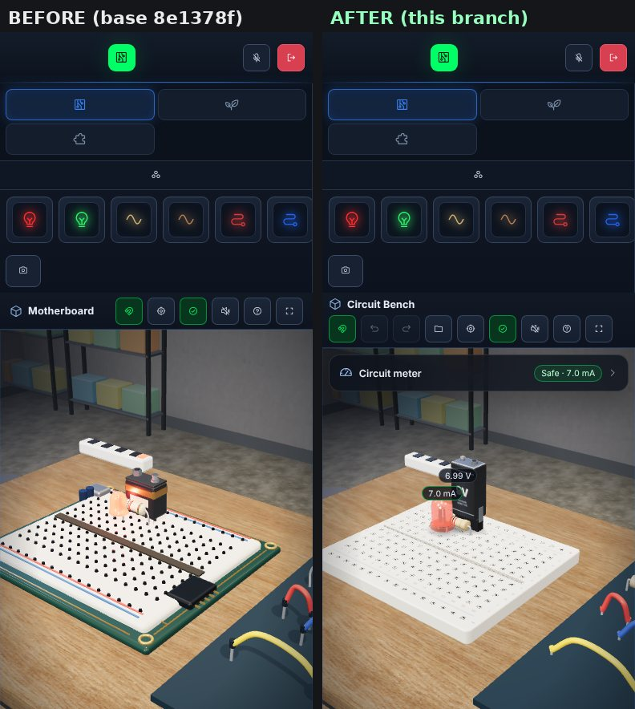
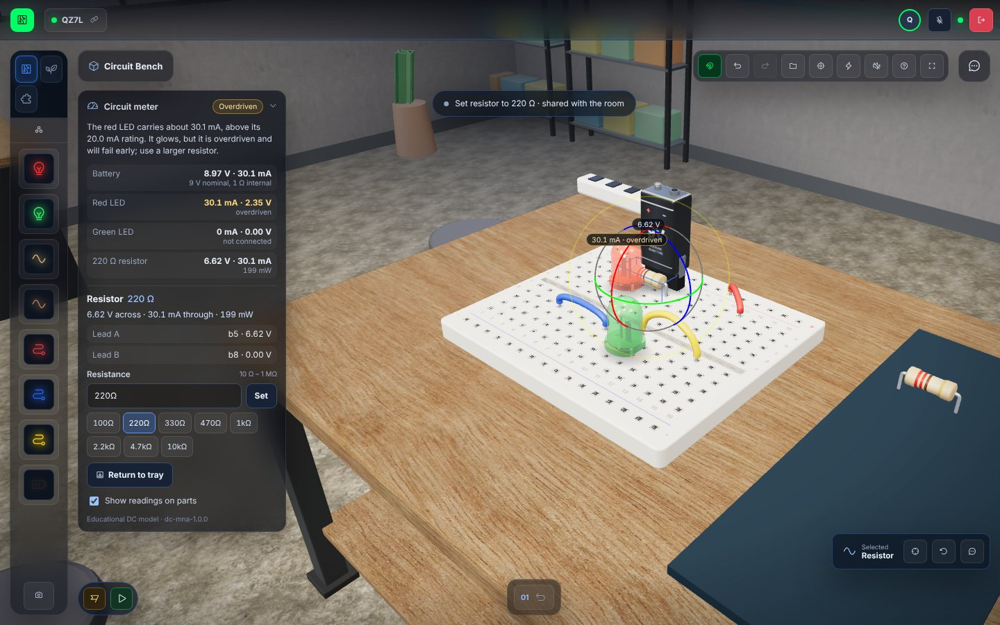

# Circuit engine, inspector and project workflow

This document describes the Circuit Bench upgrade on `feat/circuit-workbench-upgrade`
(stacked on PR #2, `feat/teachable-ai-teammate`). It covers the shared DC engine, how its
result drives every view, the inspector, editing and project files, the 3D bench models,
migration notes for researchers, and what is **not** implemented.

## One electrical truth

Before this branch there were three different circuit evaluators. They all treated resistors
like wires, lit an LED in either polarity, and used a constant brightness:

| Before | Where | Now |
|---|---|---|
| `evaluateCircuit` (net union) | `src/desktop/scene.ts` | Calls the engine through `analyzeCircuit` |
| `analyzeCircuit` (duplicate union) | `src/desktop/circuit-topology.ts` | Wraps the engine; adds Bolt's layout reasoning |
| `CircuitEvalSystem` (net union) | `src/systems/circuit-eval-system.ts` | Legacy by default; engine with `?circuitModel=dc`; DC result always logged |

The engine lives in `src/circuit/` and has no DOM or three.js dependency:

- `dc-engine.ts`: netlist validation and the solver (`solveCircuit`), `SOLVER_VERSION = "dc-mna-1.0.0"`.
- `breadboard.ts`: socket → net mapping (`socketNet`), the netlist builder (`buildBoardNetlist`)
  and `analyzeBoard` (success, glowing/safe/overdriven/burnt/reversed LEDs, net voltages).
- `part-props.ts`: editable values (`ohms`, `volts`), their bounds, rounding, parsing ("4.7k")
  and the resistor color code.

The desktop scene (LED glow, status line, the check button), the inspector, Bolt's planner and
reactions, and the tests all read the same `CircuitAnalysis`.

## Model and educational approximations

The solver uses **modified nodal analysis**: one unknown per node voltage and one per voltage
source current. The dense system is solved by Gaussian elimination with partial pivoting.

| Part | Model | Notes |
|---|---|---|
| Battery | Ideal source in series with a 1 Ω internal resistance | Real 9 V cells are about 1–2 Ω when fresh and sag non-linearly; there is no state of charge. |
| Resistor | Ideal, value from the part (10 Ω – 1 MΩ, three significant figures) | Power is reported, but there is no thermal model or power rating. |
| LED | Two segments: *off* = 1 nS leakage; *on* = forward drop Vf in series with 15 Ω | Red Vf ≈ 1.9 V, green ≈ 2.1 V. This is not the Shockley exponential, so currents are representative only to about 10–20 % in the 1–30 mA range. |
| Jumper wire | 0.05 Ω | Its current can be shown, and a wire across the battery reads as a short. |
| Breadboard strip | Ideal join | Rails are rows 0 and 11, and columns join rows a–e and f–j. |

The solver iterates the LED states. It flips the single most-inconsistent LED each pass (at most
60 passes), so the states cannot oscillate. If they never settle, the result is flagged
`non-convergence` and nothing is shown as working.

For robustness, every node gets a 10⁻¹² S conductance to ground, so floating islands keep the
matrix regular. Floating parts are found by graph search and reported as such, never as 0 V. A
second battery in its own separate loop is tied to the reference by a single bridge, which
carries no current. A numerically zero pivot returns `singular`.

**Diagnostics** carry a code, a severity and a plain-language message:

| Code | Severity | Meaning |
|---|---|---|
| `invalid-input` | error | A rejected part, such as a NaN/∞/out-of-range value, an unknown kind, a duplicate id or a socket that does not exist. The part is left out, and the status is `invalid`, never `ok`. |
| `no-source` | info | No battery is placed. |
| `open-circuit` | info | A battery is placed but delivers less than 1 µA. |
| `short-circuit` | error | The battery's terminals are joined, they are joined by jumper wires alone (at any voltage — a 1 V cell through a jumper is a short even at 0.95 A), or a source or wire carries more than 1 A. A short is never treated as success, and LEDs show dark. |
| `reverse-led` | warning | An LED is reverse-biased by more than 0.5 V. |
| `led-reverse-overvoltage` | error | A reversed LED has more than 5 V (a typical datasheet maximum) across it. The circuit is `unsafe` and never a success, even if another LED is lit. |
| `led-overcurrent` | warning | The LED is **above** its 20 mA rating (strictly: 20.0 mA is within it, 20.5 mA is not — there is no tolerance band) but below 100 mA. It glows, but the circuit is `unsafe` and not a success. |
| `led-burnout` | error | 100 mA or more, for example an LED with no resistor on 9 V (about 440 mA). The LED briefly flashes, then shows dark and scorched. |
| `floating` | info | A part is not connected to the battery's circuit. |
| `singular` / `non-convergence` | error | The circuit could not be solved, so nothing is shown as working. |

The overall `status`, most severe first, is `invalid` (always: any rejected part means the
readings describe a different circuit, so it outranks even `singular`, `short-circuit` and
`unsafe`), `singular`/`non-convergence`, `short-circuit`, `unsafe` (an LED over its rating,
burning out, or more than 5 V in reverse), `open-circuit`, `no-source`, then `ok`. *Open* is
topological: it means no conducting path (resistors, wires, LEDs that are on, and any *other*
source — cells in series) runs from a battery's + back to its −. A closed 2 MΩ loop carrying 0.75 µA is therefore `ok`,
not open, while a loop blocked only by a backwards LED is open. Pivots are judged against their
own row, and every solution is checked by its residual. A stiff 1 mΩ source next to floating
parts still solves, and a near-singular system is refused rather than trusted.

A circuit is a **success** only when all of these hold: it solved, it has no error-severity
diagnostic, at least one LED is `lit` (above 10 % of its rating, up to and including it), and no
LED is overdriven or reverse-overvolted.

### Worked example: why the safe plan uses 1 kΩ

At 9 V a red LED drops about 1.9 V, leaving about 7 V for the resistor:

- **220 Ω:** about 7 V / 236 Ω ≈ 30 mA. That is above a 5 mm indicator LED's 20 mA rating, so it
  is *not* a safe 20 mA example at 9 V. (The rough "9 V − 2 V over 220 Ω ≈ 32 mA" estimate gives
  the same answer.) The engine reports `led-overcurrent`.
- **1 kΩ:** about 7 V / 1016 Ω ≈ 7.0 mA, which is safe and clearly lit. Bolt's taught plan, the
  diagnostic demo and the e2e tests use 1 kΩ.
- 220 Ω *is* a safe example at 5 V: about 13 mA.

A plain series resistor does not by itself stop an LED from lighting. Treating it as a wire, as
the old evaluators did, removed its voltage drop, not its connectivity.

## Polarity convention

Lead A is `sockets[0]`, the part's local −x end. For a battery it is **+**; for an LED it is the
**anode** (the long lead; the flat side of the flange and the larger anvil inside the resin mark
the cathode, lead B). The XR spawner already used this convention (`posTerm` at −x).

Bolt's plans place the battery with + toward the chain, so every planned LED is forward-biased.
The old demo layout had the LED backwards; it now uses `led-red: [53, 52]`.

## Shared bench protocol (one state for every participant)

The room — the Durable Object in production, `server/collaboration.mjs` locally, both using
`cloudflare/room-core.js` — is **authoritative**. The client rules are in
`src/desktop/sync-replica.ts`; `scripts/sync-check.mjs` drives several replicas against the real
room core with adversarial message delays, and `scripts/e2e-worker-sync.mjs` repeats the key
races against `wrangler dev`.

- **Revisions.** Every accepted change to a part bumps its revision; the room stores the last
  accepted whole-part state. The program has its own revision.
- **Edits** (value changes, undo/redo, project import, reset, return to tray, demo layouts, slide
  switch, restoring an attempt, rotation reset, program upload/stop) are one atomic message: the
  changed parts with the revision each was based on (`expectRev`), optionally a program. The room
  accepts the whole batch or refuses it — `held` (someone else holds a part or one of its cable
  ends) or `stale` (a part or the program changed since). **Nothing is applied optimistically:**
  the sender applies an edit when the room accepts it, everyone else when the room relays it, in
  the room's order. So two concurrent edits (470 Ω vs 220 Ω) can no longer leave the two clients
  with each other's value: one is accepted everywhere, the other is refused and changes nothing.
- **Live drags** need a claim, and the room accepts a move only from the claim's holder (or the
  holder of the whole cable, for a cable end). A refused claim or move comes back with the room's
  authoritative state (`claim-denied` / `transform-rejected`), which replaces the sender's local
  guess even if the holder disconnects without sending a final move. A newer own move still in
  flight takes precedence over an older refusal.
- **Claims:** holding a whole part conflicts with either cable end, and an end conflicts with the
  whole part — both ways, for humans and Bolt alike. Edits touching a held end are refused whole.
  Two people may each hold one end of the same cable; the room merges cable-end moves per end.
- **Joining / reconnecting:** the room answers `hello` with `room-state` (authoritative parts,
  revisions, current claims, the program). Parts it does not list are at their defaults. A room
  with no bench state (new, or everyone left) is seeded by the first returning bench as one edit;
  a refused seed re-requests the room's state. Moves are paused while reconnecting.
- **Timeouts:** an edit unanswered after 8 s stops blocking the learner ("not confirmed in
  time", not added to undo), but stays pending: if the room did accept it, the late answer still
  applies it here exactly as everyone else applied it.
- **Claims survive Durable Object hibernation** (they ride on each holder's socket attachment).
  The local relay never forwards room-only replies (`room-state`, `edit-result`, …) from clients.
- **History and traces follow acceptance.** An undo step, an `edit` trace, a `claim` trace (on
  `claim-granted`) or a `move` trace (all of the drag's moves acknowledged) is written only after
  the room accepted it. Refusals show a status message and change nothing.
- **Same-device tabs** without a server (localhost, BroadcastChannel) have no arbiter: edits and
  moves apply at once and carry Lamport stamps, and every tab keeps the highest stamp per part,
  so concurrent changes converge on one winner. A joining tab adopts the clock (and the Snapino
  program) of the tab that hands it the bench. Claims there are advisory.
- `SharedTransform.props` (`{ ohms?, volts? }`) is validated by the Worker with the same bounds
  and rounding as `src/circuit/part-props.ts`. Live moves never carry values; the room keeps the
  accepted ones; the same holds for the slide-switch state (`on`), which only edits change.
  Every validator is strict (no coercion: `"36"`, `true` or `{valueOf}` are not
  numbers) and never throws.

## Inspector (circuit meter)

The meter is a floating, collapsible glass panel in the Circuit Bench. Its collapsed state is
remembered per browser, and it starts collapsed on phones. Everything it shows comes from the
engine result:

- A status pill (*Safe · 7.0 mA*, *Overdriven*, *LED burns out*, *Short circuit*, *Open circuit*,
  *LED reversed*) and the diagnostic explanation.
- Readings with units: battery terminal voltage and current; each LED's current, voltage and
  state; each resistor's voltage, current and power; and wire currents when non-zero.
- For the selected part: lead A/B with polarity names, each lead's hole (`c5`, `+ rail, column 3`)
  and that net's voltage, live V/I/P, and **Return to tray**.
- Bounded value editing:
  - Resistors: 10 Ω – 1 MΩ, typed (`470`, `4.7k`, `1M`) or as preset chips.
  - Battery: 1–12 V, typed or as presets.
  - Out-of-range or unreadable input is refused with an explanation.
- Optional measurement tags that float over the LEDs (current) and resistors (voltage).

## Undo/redo, project files, recovery, reset

**Undo/redo** (toolbar buttons, Ctrl/Cmd+Z, Ctrl+Shift+Z or Ctrl+Y) covers only *your own*
edits that the room accepted: moves, value edits, return-to-tray, demo layouts, imports
(including program-only imports) and reset.

- An undo is checked locally first: every affected part (and, for an import, the room program)
  must still match its post-edit state. If a teammate or Bolt changed it since, the step is
  refused as stale ("their work is kept") and discarded. The room checks again by revision, so a
  change that has not reached this client yet also refuses it.
- A part currently held by someone else blocks the step without discarding it; so does being
  offline or an unanswered request.
- **Program policy:** an import, undo or redo that restores a program leaves it **stopped** — an
  import stops a running program even when the file holds the very same statements (sent in the
  same atomic edit as any part changes; a stop alone is not an undo step) —
  press Run to start it. Run/Stop are not undo steps, and programs are compared by statements.
  A stale undo can never overwrite a teammate's newer program.
- History is cleared on a studio change.

**Project files** (toolbar folder menu → Export / Import):

- The format is `virtual-makerspace.project`, version 1. It holds sockets per part, electrical
  values, slide-switch state and, on Snapino, the **room's** program (`program`) and — only if
  the exporter's editor has unsaved edits — that draft separately (`draftProgram`). Importing a
  draft puts it in the importer's own editor; it is shared only when they press Run.
- It holds no participant ids, names, chat, traces, recordings or tokens, and no positions.
- Import is capped at 64 KB and uses a strict, type-checked schema (`parseProject` never throws,
  even on `{"version": {"toString": 0}}`). Unknown fields are dropped; nothing is rendered as HTML.
- Import asks for confirmation, refuses while Bolt is building, and is one atomic room edit and
  one undo step.

**Local recovery:** this browser keeps the latest bench for the room and studio
(`localStorage`): parts, values, the room program and any draft. It saves after every change —
local or a teammate's, edits, imports, undo, program-only changes. Only a bench entirely at its
defaults (nothing seated, every value at its default, switches off, no program or draft) clears it;
edited values on parts left in the tray (e.g. a resistor set to 470 Ω) are kept and recoverable. On re-entry, if the saved parts, values or program differ from
the room's, a banner offers to restore them (as one undoable edit). Never automatic.

**Reset bench** (with a confirmation dialog) returns every part of the studio to the tray with
default values, as one undoable shared edit.

**Not implemented:** duplicating parts or adding parts from a catalog. Part ids are a fixed set,
enforced by the Worker's `COMPONENT_IDS`, the scene and Bolt. Dynamic ids would need protocol,
Worker, scene and research-schema changes, so no non-functional "duplicate" button was added.

## Snapino code: honest scope

The Snapino studio still runs **block statements** in a limited in-browser runner: pin on/off,
wait, and follow S1.

- The **Run blocks** button (formerly "Upload & Run") says what it does.
- The code panel shows the generated `.ino` sketch with a header stating that the bench did not
  compile or emulate it. **Download .ino** and **Copy** let learners build and upload it with the
  Arduino IDE.
- `scripts/snapino-sketch-check.mjs` checks every example and a set of generated programs with
  `g++ -fsyntax-only -Wall -Werror` against a minimal stub `Arduino.h`. This proves the C++ is
  well-formed and uses only `pinMode`/`digitalWrite`/`digitalRead`/`delay`. It is not an AVR
  build.
- **Not implemented:** compiling or emulating arbitrary Arduino/AVR sketches in the browser. The
  Nano model on the carrier carries a silkscreen note: "BLOCK RUNNER · NOT AN AVR EMULATOR".

## 3D bench models (`src/desktop/bench-models.ts`)

These are original procedural meshes, with no external or paid assets. 1 scene unit ≈ 10.6 mm
(0.24 units = 2.54 mm pitch).

- **Breadboard:**
  - A bevelled ABS frame and a printed top skin with real square cut-outs (alpha-tested) at
    exactly the picking/snap socket coordinates.
  - Through each hole you see a dark cavity floor, instanced hole walls and instanced nickel
    spring leaves.
  - A real center trench, red "+" and blue "−" rail stripes and marks, column numbers 1–16 and
    row letters a–j.
- **LED (5 mm):**
  - A lathe-turned tinted resin dome (clear-coated, translucent) and a flange with the
    cathode-side flat.
  - Visible post and anvil internals, and tinned leads that stop at the hole floor.
  - Emission follows the engine's current, kept moderate so the tint stays saturated. A burnt-out
    LED flashes, then shows a dark, smoky core.
- **Resistor (¼ W):**
  - A lathe body with bulged end caps and bent axial leads.
  - Color bands drawn from the actual value: 4-band carbon film (beige) when two digits are exact,
    otherwise 5-band metal film (blue, 1 %). Bands update when the value is edited.
- **9 V battery:**
  - A rounded graphite shell with a voltage label (it updates with the edited supply), a metal
    top, and a round + snap and hexagonal − snap above lead A and lead B.
  - It stands in a slim vertical PCB-mount clip (one row deep) whose pins are the leads; the
    shell starts above resistor height so parts in neighbouring rows are not buried in it.
  - Drawn at 25 % scale (true 26.5 × 17.5 × 48.5 mm proportions) so it does not bury the
    16-column board; everything else is 1:1. (A real 9 V battery would connect through a snap
    clip with wires; LEDs in directly adjacent holes can still touch, as real 5 mm LEDs do.)
- **Jumper wires:** smooth centripetal Catmull-Rom insulation that rises vertically out of each
  hole, ends just above the board, and continues as a bare tinned conductor down to the hole
  floor, anchored to the exact socket points.
- **Snapino PCB:** the Blender-built board gains a silkscreen with pin names, a "SNAPINO" title,
  the not-an-emulator note, and two rows of header strips with gold pins.
- **Materials and lighting:**
  - A PBR palette that separates matte ABS, tinned and nickel metal, resin, PVC and the label.
  - A hemisphere fill, one shadow-casting key light with a frustum fitted to the bench, a warm
    pendant, a cool rim and a dim room environment for reflections.
  - Soft contact-shadow decals under seated parts.
  - No bloom or post-processing.

**Performance budget:** holes, walls and contacts are 3 instanced meshes, and geometry and
materials are shared through a module cache.

- **Shadows:** the shadow map re-renders only for a few frames after something changes
  (`shadowMap.autoUpdate = false`), not every frame.
- **Quality tiers:** `?quality=low|medium|high`. *Low* is pixel ratio 1, no shadows and no LED
  point lights. *Medium* (the default on desktop) is a pixel ratio of at most 1.5 and a 1024
  shadow map. *High* is a pixel ratio of at most 2 and a 2048 shadow map. Coarse-pointer devices
  and devices with 2 or fewer cores start on *low*.
- **Adaptive resolution:** averages above 33 ms per frame step the pixel ratio down within the
  tier; averages below 14 ms step it back up, a bounded number of times.

The WebXR path (`src/index.ts`, IWSDK) does not use these desktop models. Its geometry is
unchanged, and **no Quest performance claim is made**: this was not measured on a headset.

### BEFORE / AFTER (same placements and camera, `scripts/qa-3d.mjs`)

Matched side-by-side sheets (base 8e1378f on the left, this branch on the right; identical
camera, placements, viewport and default quality) are in [`images/qa/`](images/qa/README.md),
with the raw renderer counters in [`images/qa/stats.json`](images/qa/stats.json):









AFTER-only detail: 

Renderer counters (SwiftShader in headless Chromium, pixel ratio 1, default quality; steady-state
frames, shadow map cached between changes):

| View | Draw calls before → after | Triangles before → after |
|---|---|---|
| Circuit overview (panel open, 1440×900) | 508 → 271 | 79k → 41k |
| Circuit overview (panel collapsed) | 364 → 164 | 72k → 36k |
| Laptop 1180×760 | 534 → 266 | 77k → 38k |
| Phone 390×844 | 293 → 131 | 59k → 29k |
| Snapino overview (unchanged GLB) | 1220 → 1229 | 96k → 97k |

These are software-rendered captures; they say nothing about frame rate on a real GPU, phone or
Quest headset, none of which were tested.

## Research migration notes

- **Desktop `powered` / check-button meaning changed:** it now means *safe success*. Before, it
  meant "an LED's nets equal the battery's nets in either polarity". Two consequences:
  - Strips plus loop with no resistor is now a *burnout*, not a success.
  - A reversed LED or 220 Ω at 9 V is no longer a success.

  Sessions recorded before this branch should be compared on the old definition.
- **Bolt:**
  - The taught plan uses `resistor-1k`.
  - Test reactions name the current ("about 7 mA, inside the LED's 20 mA rating"), report
    burnout, overdrive, reversed LEDs and shorts, and keep the naive-idea phrasing in DI.
  - Its belief model, learning rules and `teach` traces are unchanged.
- **Trace schema:** a new `edit` action, so `claim`/`move` counts are unchanged by value edits,
  undo, import or reset. The Worker allows `edit`. The test-trace wording ("Ran motherboard
  power-path test") is unchanged even though the studio heading is now "Circuit Bench".
- **XR telemetry:**
  - `led_state_change` keeps `{ entity_id, lit }` with legacy semantics and adds
    `circuit_model`, `solver_version` and `dc_lit`.
  - A new event `circuit_dc_eval` (`solver_version`, `circuit_model`, `entity_id`, `dc_state`,
    `dc_lit`, `current_ma`, `status`) is logged when the placement changes.
  - `markTaskComplete` keeps legacy semantics unless `?circuitModel=dc`.
  - XR resistors carry nominal values (gold body = 220 Ω, brown body = 1 kΩ) in
    `CircuitNode.ohms`.
- **Protocol:** `SharedTransform.props` is optional and backward compatible (absent = unchanged).
  New message kinds: `edit`, `edit-result`, `rev-ack`, `transform-rejected`, `claim-granted`,
  `claim-denied`, `room-state`, `room-state-request`. Clients from before this branch are not
  compatible with a room running it (their optimistic moves without a granted claim are refused).
- **Traces now follow the room:** `claim` is recorded when the claim is granted and `move` when
  all of a drag's moves were accepted; refused drags and edits leave no trace. Counts from older
  sessions included refused attempts.

## Tests

```bash
npm test              # typecheck + engine + agent + project-state + Snapino (g++ syntax) + sync races + WorkbenchTools
npm run build
node scripts/e2e-ai-teammate.mjs http://localhost:4173          # BroadcastChannel, one browser
# With wrangler dev on :8799 and scripts/access-proxy.mjs on :8800 (fresh random rooms):
node scripts/e2e-ai-teammate-worker.mjs                        # Bolt over the Durable Object
node scripts/e2e-room-sync.mjs                                 # studio lock, program sync, late joiner
node --experimental-strip-types scripts/e2e-worker-sync.mjs    # edit races, claims, disconnects, hostile messages
node scripts/e2e-snapino-history.mjs                           # P/S → import Q/T → undo → redo, export, recovery
node scripts/e2e-cable-end.mjs                                 # cable ends through the real drag path, two holders
node scripts/qa-3d.mjs http://localhost:4173 ./qa-3d [quality]  # renders + renderer counters
```

## Known limitations

- The model is DC-only: no capacitors, inductors, transients, AC, temperature or battery
  discharge. It is not SPICE, and LED currents are approximate (see the table above).
- The only editable values are resistance and supply voltage. LED color and forward voltage are
  fixed per part.
- The catalog is fixed. No duplication or new parts are possible (see above).
- Undo history is per browser tab and is lost on reload. Local recovery covers the bench state,
  not the history.
- Edits wait for the room (one round trip) before they show; with no connection they are refused
  rather than queued, and moves pause while reconnecting.
- Same-device tabs without a server converge by Lamport order, but their claims are advisory
  (there is no arbiter), so two tabs can grab the same part at once there.
- Arduino sketches are generated and syntax-checked only. There is no AVR compile, upload or
  emulation.
- The renders were checked with software WebGL (SwiftShader) in headless Chromium. They were not
  checked on real GPUs, phones or a Quest headset.
