# Episode 3 · Resource-Limited Greenhouse — renders of the first submission (`faa7c09`)

> These are the renders of app `faa7c09`, which the first gate did not accept. They were moved here, unchanged, when the correction round's renders (app `b8d099a`) took their place in [the folder above](../README.md).

**App code:** `faa7c09`, the app first submitted in this PR, built with `npx vite build` in its own worktree and its own `dist/`; `record.json` names it.

**Where:** a developer environment (headless Chromium with SwiftShader software WebGL, 2 CPU cores). These are not GitHub CI runs.

**Rooms:** fresh random local same-device (peer) rooms (`Q…` codes). The production room 7K3M was never used.

**Script:** `node scripts/qa-greenhouse.mjs http://127.0.0.1:4173 <dir> <sha>`, run against a static server over `dist/`. It ran 3,286 s with no issues and 12/12 checks ([`record.json`](record.json), [log](../../../../qa/greenhouse/app-faa7c09/qa-greenhouse.txt)). The images are JPEG (quality 84) conversions of the PNG captures.

The renderer counters are the draw calls and triangles of the frame shown. They are **not** frame rates. Nothing here was measured on a GPU, phone or Quest, and no XR view of the studio exists. 390×844 is a viewport check in desktop Chromium, not testing on a phone.

## Checks in this run

| Check | Result |
|---|---|
| 1440×900 overview: the greenhouse's projected width ÷ the free width between the parts rail and the dock | **0.914** (≥ 0.6) |
| 1280×720 overview, same measure | **0.919** |
| Camera keys `2` and `3` frame different views | yes |
| Wrong build (tank straight to bed A, valve A OUT → valve B OUT, a loose cable end) drawn as built, nothing flows | hose 1 `no-pump`, hose 3 `out-out`, cable 1 `loose` |
| Mid-day, paused at 13:00 (step 28): resources from the model; water and energy ledgers balanced | tank 25.6 L; residuals 0 |
| Dock collapsed: the day keeps running, the HUD clock follows | 07:45 → 08:45 with the dock hidden |
| Failure: the default allocation on the brief's day | G1 met; bed A 0 h; **bed B 9.5 h** out of range; air above 35 °C **1.5 h**; 16.0 L left |
| Recovery: the worked allocation | all five met: bed A 0 h, bed B 1 h, air 0 h, 11.2 L left |
| Phone 390×844: horizontal overflow | 0 px |
| Phone: *Start the day* reached by Tab after real wheel scrolling | yes; 129.8×44 px |
| Phone: every visible control in the Greenhouse tab at least 44 px tall | yes (none smaller) |
| PF: no worked example | hidden |

## Shots

| Shot | Viewport | Draw calls | Triangles |
|---|---|---:|---:|
| `01` overview, nothing built (DI, brief and worked example) | 1440×900 | 252 | 53,682 |
| `02` overview | 1280×720 | 251 | 53,574 |
| `03` top (key `2`) | 1440×900 | 241 | 53,422 |
| `04` beds (key `3`) | 1440×900 | 199 | 50,358 |
| `05` wrong build, as built | 1440×900 | 261 | 57,394 |
| `06` the brief's rig, paused at 13:00 | 1440×900 | 253 | 53,682 |
| `07` close-up: pump and manifold ports | 1440×900 | 227 | 52,074 |
| `08` close-up: the beds, the probe in bed A | 1440×900 | 128 | 34,838 |
| `09` failure: the default allocation's day | 1440×900 | 253 | 53,682 |
| `10` recovery: the worked allocation's day | 1440×900 | 253 | 53,682 |
| `12` phone, top | 390×844 | 233 | 52,074 |
| `13` phone, dock reached by wheel and Tab | 390×844 | 233 | 52,074 |

`05b`, `06b`, `09b`, `10b` and `11` are crops of the dock in the frames of `05`, `06`, `09` and `10` (`11` after the manifold was selected in the `10` frame), so they carry those frames' counters. `14` is a crop of a separate PF page at 1440×900 (252 draw calls, 53,682 triangles).

## Overview and camera views

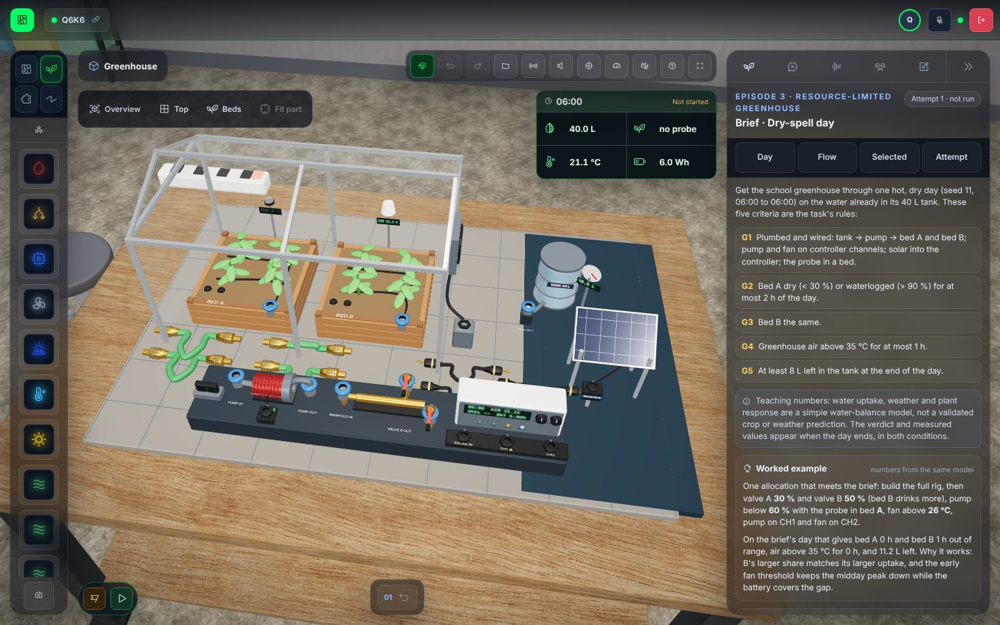

| 1280×720 | Top | Beds |
|---|---|---|
| 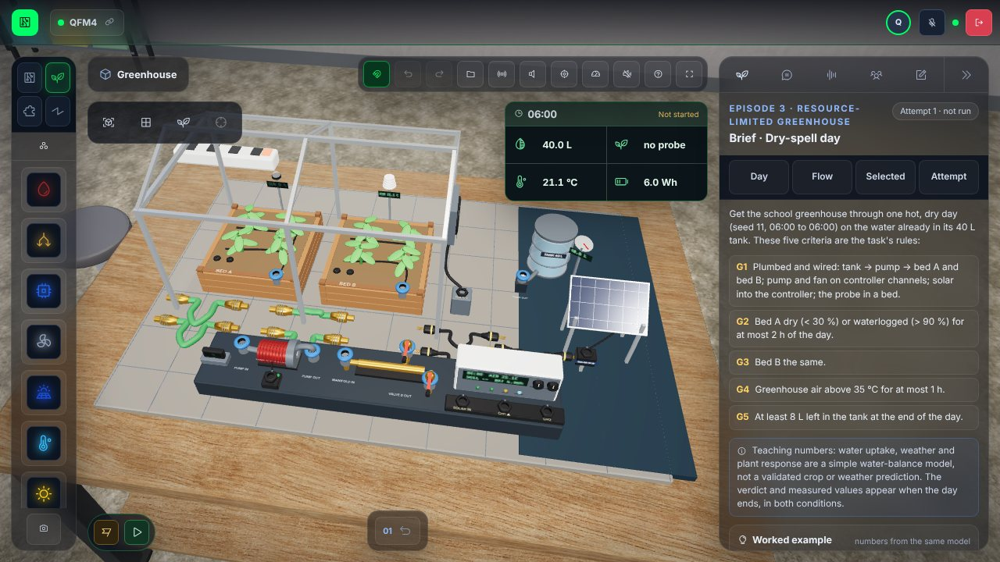 | 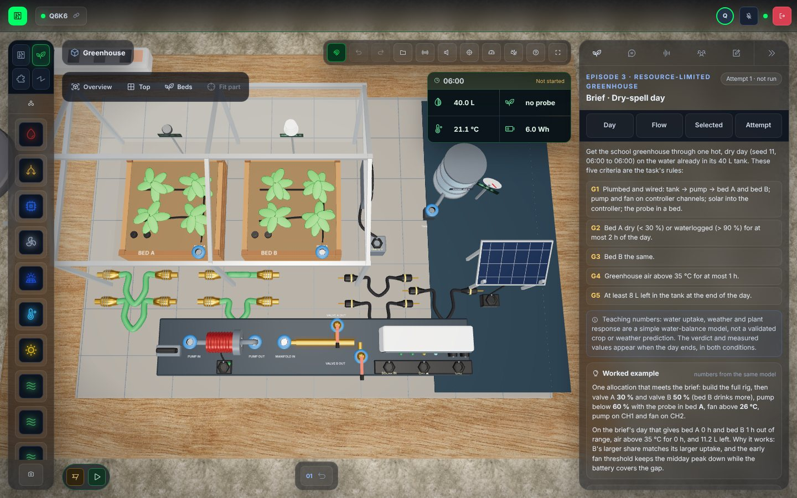 | 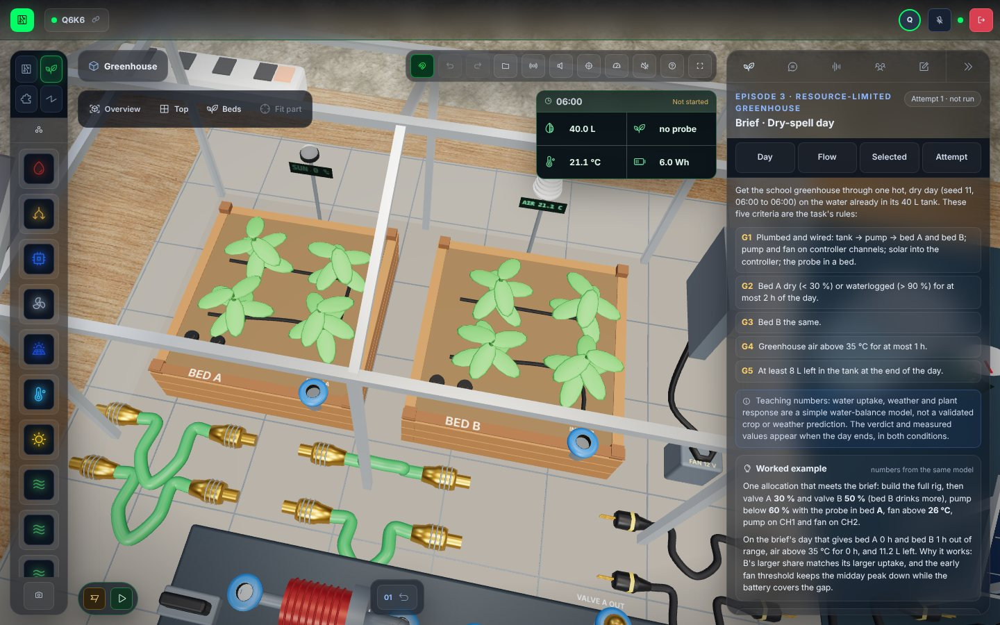 |

## Wrong build, as built

Hose 1 runs from TANK OUT straight to bed A's inlet (no pump; the tank sits below the beds), hose 3 joins valve A OUT to valve B OUT, and cable 1 has a loose end. Nothing is repaired: red fault collars sit at the ports, the diagram draws the wrong lines dotted with ✕, and the notes and the connection list say what each fault does.

| 3D | Live resource flow |
|---|---|
| 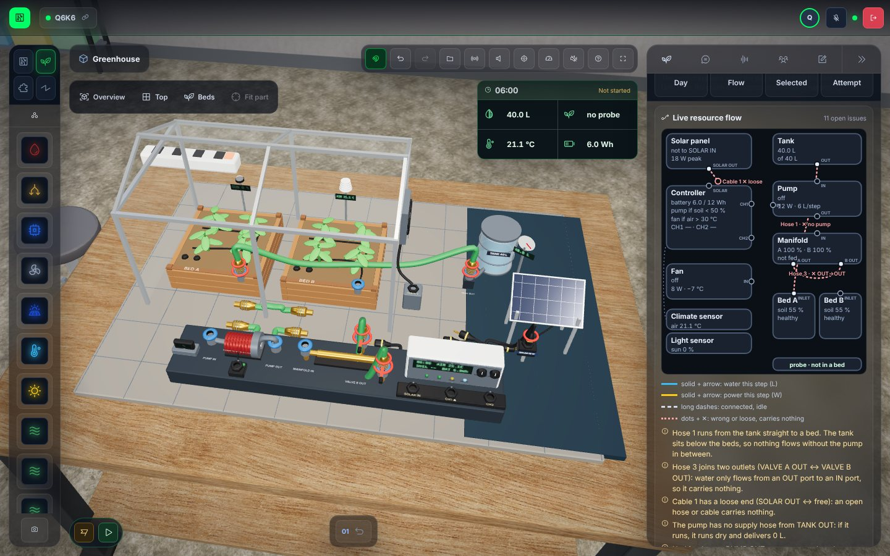 | 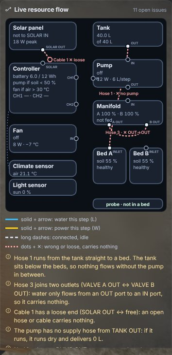 |

## The brief's rig, mid-day

The worked allocation's rig paused at 13:00 after seven *Step 1 h* presses: the graph up to the shown step, the text summary, and the HUD from the model.

| 3D | The day |
|---|---|
| 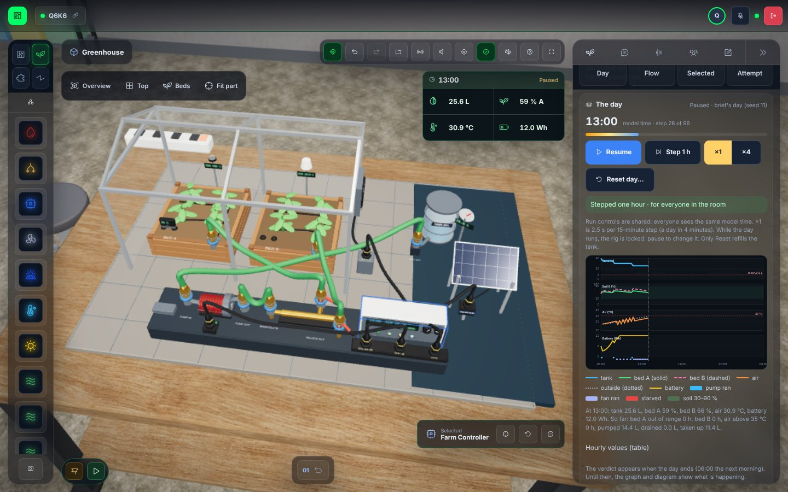 | 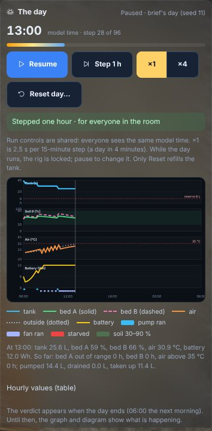 |

| Pump and manifold | The beds, the probe in bed A |
|---|---|
| 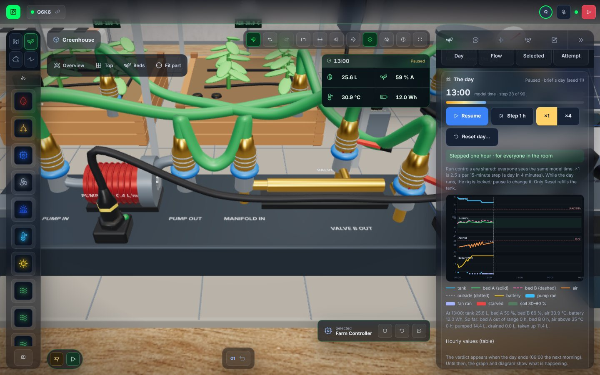 | 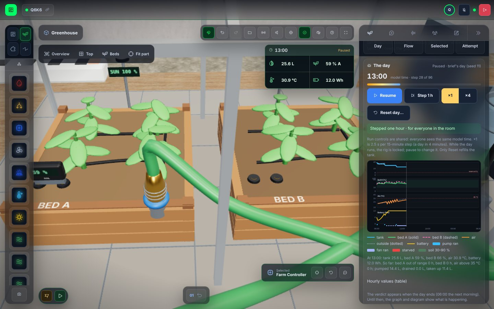 |

## Failure and recovery

The default allocation (both valves 100 %, pump below 50 %, fan above 30 °C) on the brief's day, then the worked allocation (valve A 30 %, valve B 50 %, pump below 60 %, fan above 26 °C) after *Reset day…*.

| Failure | Its verdict (DI reasons) |
|---|---|
|  |  |

| Recovery | Its verdict |
|---|---|
| 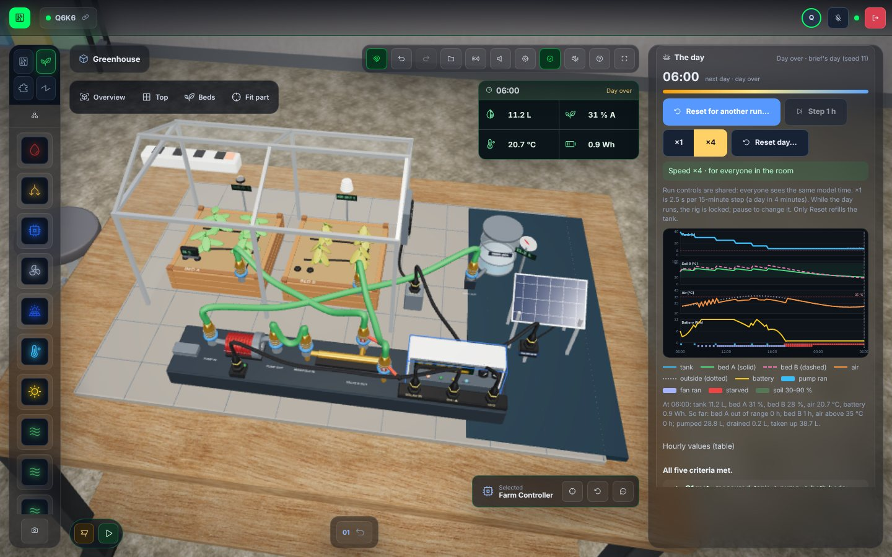 |  |

## Phone (390×844) and PF

| Phone, top | Phone, dock (wheel + Tab) | PF panel (no worked example) |
|---|---|---|
| 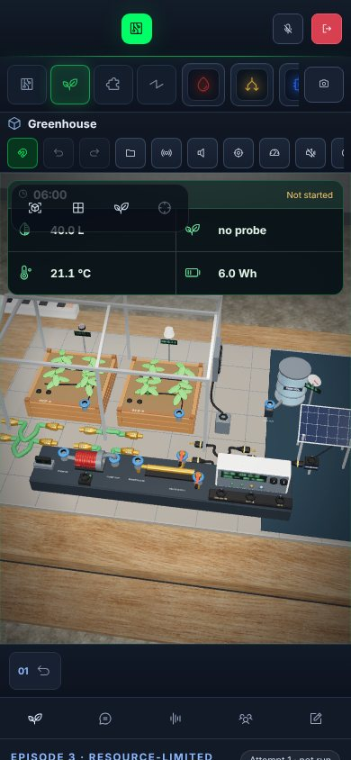 | 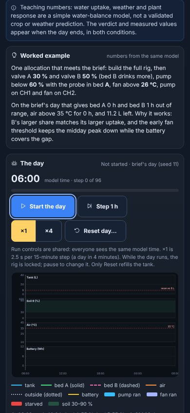 | 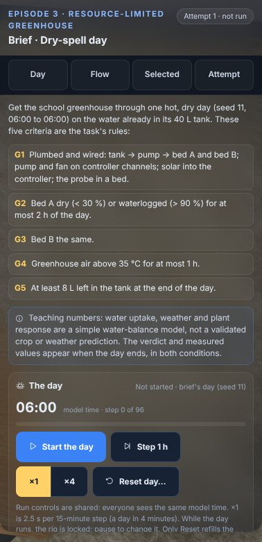 |

## Earlier capture runs

Development capture runs on earlier commits (before `faa7c09`) fed the layout, material and diagram fixes in this PR. Four such runs on development builds (not committed) each stopped early, on an error or the harness's time limit, after 5 or 12 shots; every check they reached passed. None of them is evidence of the final app, and their images are not here. The images above are all from the `faa7c09` run.
