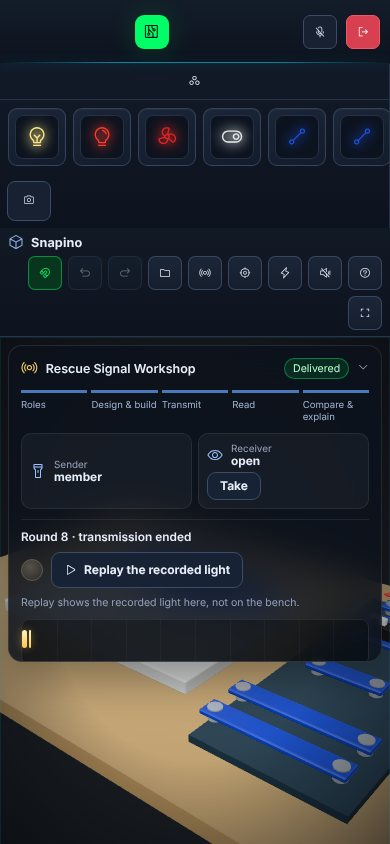

# Episode 1 · Rescue Signal Workshop — renders

**App code:** commit `89a238c` (branch `feat/makerspace-episodes`), built with `npm run build`.
**Where:** a developer environment (headless Chromium 1194 with SwiftShader software WebGL, 2 CPU cores). These are not GitHub CI runs; the repository's only GitHub check is GitGuardian.
**Rooms:** fresh random local QA rooms for every page (`Q…` and `R…` codes). The production room 7K3M was never used.

Software rendering is slow: a Snapino frame takes seconds. The renderer counters below are draw calls and triangles per view. They are **not** frame rates, and nothing here was measured on a real GPU, phone or Quest headset. No XR view of the episode exists.

## How they were made

| Set | Script | Mode |
|---|---|---|
| `e01`–`e11` | `node scripts/qa-episode.mjs http://localhost:4173 <dir>` (static `vite preview` of `dist/`) | One maker, solo sender, same-device (peer) room. Close-ups use the `?qa` camera hook. The matched lit/unlit pair drives D5 HIGH/LOW through `__vmQa.pins`, the same pin path a transmission uses. |
| `two-client-*` | `node --experimental-strip-types scripts/e2e-rescue-signal.mjs http://vm.test:8800 <dir>` (wrangler dev + `scripts/access-proxy.mjs`) | Two browsers in one room over the real Worker/Durable Object, clicking the real panel. This run passed 38/38 checks. |

JPEG (quality 84) conversions of the PNG captures. Counters for `e01`–`e11` are in [`stats.json`](stats.json).

## Overview and close-ups (1440×900)

| View | Draw calls | Triangles |
|---|---:|---:|
| `e01` overview, sender designing INJURED · NORTH | 855 | 105,658 |
| `e02` / `e03` lamp L1 lit / unlit, identical camera | 255 | 58,866 |
| `e04` low angle on L1's snaps and the D5 pad | 539 | 73,370 |
| `e05` the receiver's framing ("Receiver's view"), lamp lit | 456 | 86,990 |
| `e06`–`e09` panel states, receiver's framing | 456 | 86,990 |
| `e10` phone 390×844, panel open | 515 | 85,706 |
| `e11` phone 390×844, panel folded | 223 | 62,306 |

Lamp L1 seated on its snaps, D5 HIGH (left) and LOW (right), same camera:

| Lit | Unlit |
|---|---|
|  |  |

## Running, working, error and recovery states

- **`e06` running.** The transmission is running: progress bar, elapsed time, Stop, and the lamp lit on the bench. This capture round is one deliberately long 110 s flash, which is not a protocol word, so that a seconds-per-frame renderer can catch it. The shot was taken 100 s in, and the flash ran to its end before the script's Stop arrived (recorded in `stats.json`). Stop itself is exercised in the two-client run.
- **`e07` working round.** The solo check after the DI helper's INJURED · NORTH blocks: both words are decoded and no problems are found.
- **`e08` error.** The return wire `W2a` is off the base, which leaves an open circuit. The code ran, but there was no light at all. The diagnosis says L1 had no end reaching GND.
- **`e09` recovery.** The loop is rebuilt, the same message is transmitted again, and no problems are found.

## Phone width (390×844)

| Panel open | Panel folded |
|---|---|
|  |  |

## Two clients over the Worker (1000×680 each, 390×844 late joiner)

| File | What it shows |
|---|---|
| `two-client-01-sender-design` | The sender has chosen North ridge and INJURED · NORTH, and the DI helper has written the blocks. |
| `two-client-02-receiver-watching` | The receiver's screen, framed with "Receiver's view", right after the transmission ended. The lamp is dark, as the timeline says. |
| `two-client-03-receiver-reading` | The receiver builds the first reading. The intended message is not shown. |
| `two-client-04-sender/receiver-compare-delivered` | Both screens: intended, what the light said under the protocol, what was read, and "Message delivered". |
| `two-client-05-ambiguous-diagnosis` | A 500 ms flash: the signal is ambiguous even though the reading guessed right, with the measured flash against the bands. |
| `two-client-06-open-circuit-no-light` | The open circuit: no light reached the receiver. |
| `two-client-07-cut-off-by-bench-change` | A teammate's bench edit cut the transmission off at 10.4 s. The strip's axis is labelled every 2 s. |
| `two-client-08-phone-panel` | A late joiner on a phone gets the rounds, the current round and the roles from the room. |

