# Episode 2 · Sound Flow Studio — renders

**App code:** `63a3421`, the final app of PR #5, built with `npx vite build` in its own worktree and its own `dist/`; `record.json` names it. The same capture script also ran on `1eaf1dd` (7/7, 2,000 s), with the same draw-call and triangle counts per shot as below: the review fixes after it did not change the 3D desk.

**Where:** a developer environment (headless Chromium with SwiftShader software WebGL, 2 CPU cores). These are not GitHub CI runs.

**Rooms:** fresh random local same-device (peer) rooms (`Q…` codes). The production room 7K3M was never used.

**Script:** `node scripts/qa-sound.mjs http://127.0.0.1:4173 <dir> <sha>`, run against a static server over `dist/`. It ran 2,236 s with no issues and 7/7 checks ([`record.json`](record.json), [log](../../../qa/sound-flow/app-63a3421/qa-sound.txt)). The images are JPEG (quality 84) conversions of the PNG captures.

The renderer counters are the draw calls and triangles of the frame shown. They are **not** frame rates. Nothing here was measured on a GPU, phone or Quest, and no XR view of the studio exists. **No image or number here says anything about sound from a physical speaker:** the signal display is rendered by Web Audio in an `OfflineAudioContext`, and the live line reads this tab's analysers.

## Checks in this run

| Check | Result |
|---|---|
| 1440×900 overview: the desk's projected width ÷ the free width between rail and dock | **0.865** (≥ 0.6) |
| 1280×720 overview, same measure | **0.857** |
| Wrong patch: the loop and the loose end are drawn and diagnosed, and nothing reaches the Speaker | faults `loose-end`, `loop`, `unpatched-input` |
| Working: the brief is met, and the display shows a rendered, unclipped tone at the Speaker | met; peak 0.496 FS (−6.1 dBFS); source `rendered`; audio `running` |
| Phone 390×844: horizontal overflow | 0 px |
| Phone: *Test patch* is reached by Tab after real wheel scrolling | yes; the target is 116.6×44 px |
| PF: no worked example | hidden |

## Shots

| Shot | Viewport | Draw calls | Triangles |
|---|---|---:|---:|
| `01` overview, the cables on the mat (DI, Studio tab) | 1440×900 | 202 | 40,832 |
| `02` overview | 1280×720 | 202 | 40,832 |
| `03` plan (key `2`) | 1440×900 | 203 | 41,036 |
| `04` the listener's view (key `3`) | 1440×900 | 191 | 35,638 |
| `05` jacks close-up, all three cables seated | 1440×900 | 125 | 27,130 |
| `06` Source knob close-up | 1440×900 | 69 | 13,218 |
| `07` Speaker close-up | 1440×900 | 76 | 17,770 |
| `08` wrong patch: a loop and a loose end, with the Inspector | 1440×900 | 207 | 41,600 |
| `09` working: the brief met, live audio on this tab | 1440×900 | 207 | 41,472 |
| `10` after the explanation, muted | 1440×900 | 207 | 41,472 |
| `11` phone, top | 390×844 | 201 | 41,220 |
| `12` phone, dock reached by wheel and Tab | 390×844 | 201 | 41,220 |

`08b`, `09b` and `09c` are element crops of the frames of `08` and `09`, so they carry those frames' counters. `13` is a crop of a separate PF page at 1440×900 (202 draw calls, 40,832 triangles).

## Overview and camera views

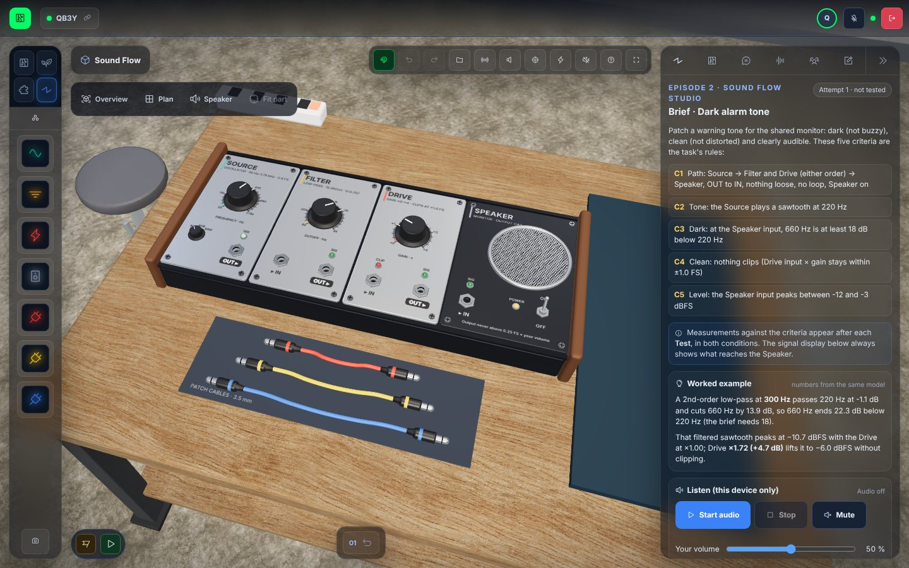

| 1280×720 | Plan | Listener's view |
|---|---|---|
| 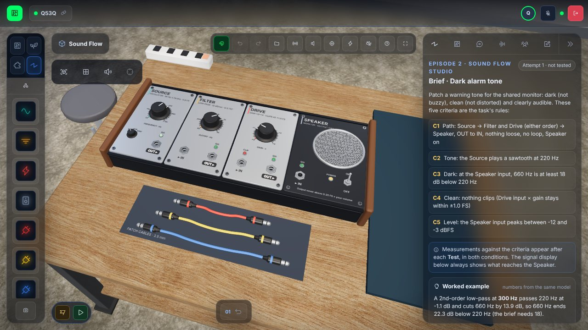 | 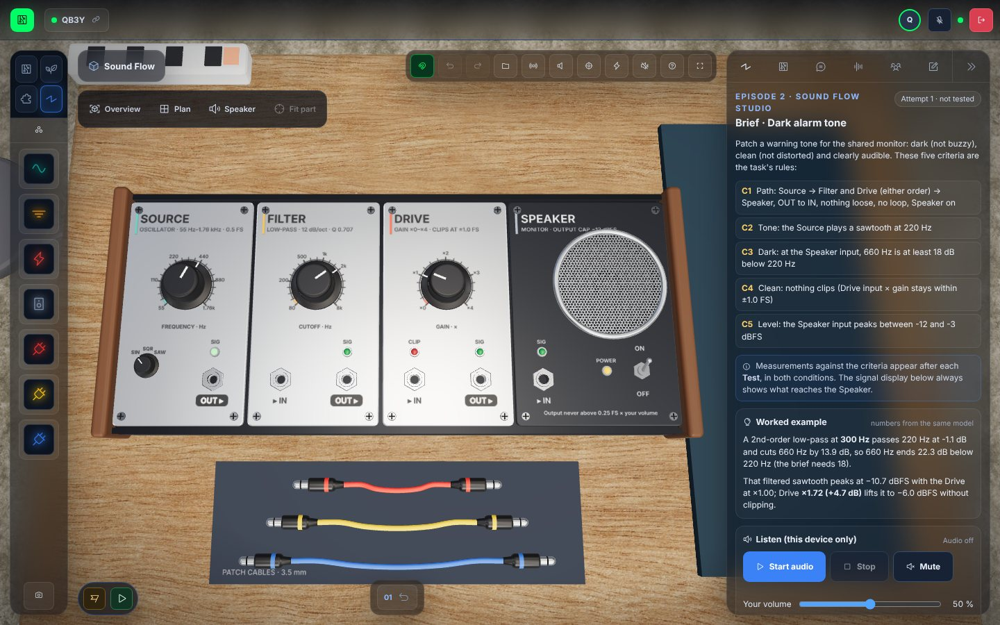 | 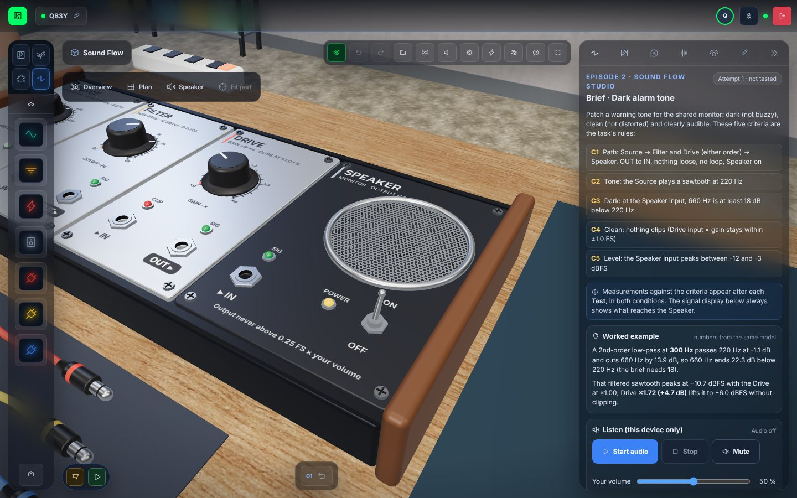 |

## Close-ups

The plugs' sleeves sit inside each jack's drilled bore. The knob is knurled and skirted, with a printed scale. The Speaker has its grille, LEDs and power toggle.

| Jacks | Knob | Speaker |
|---|---|---|
| 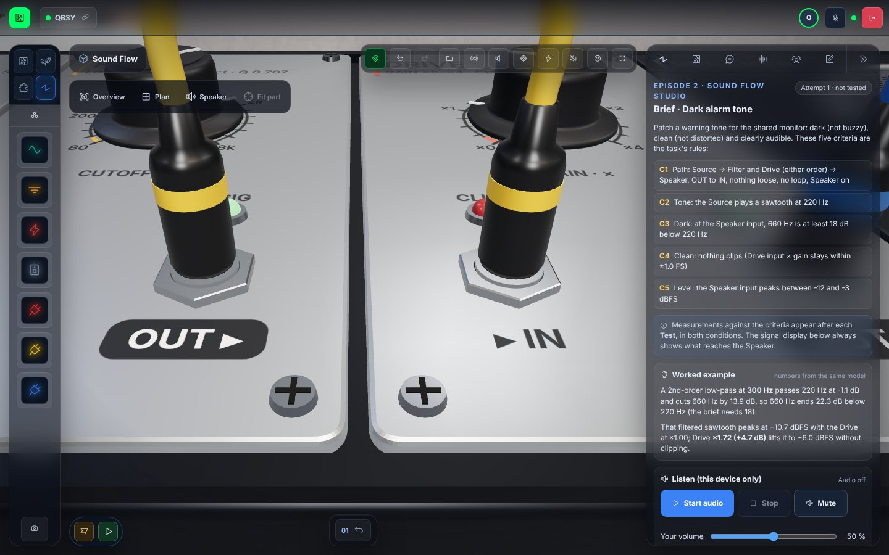 | 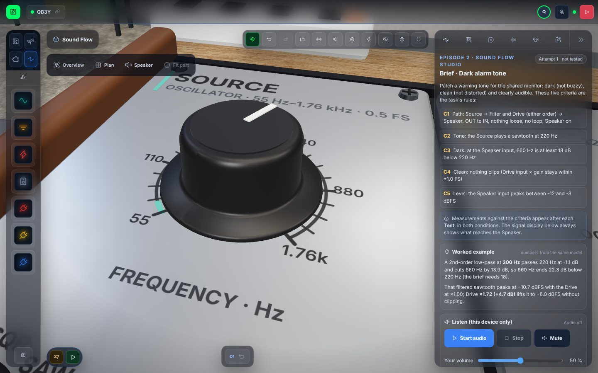 | 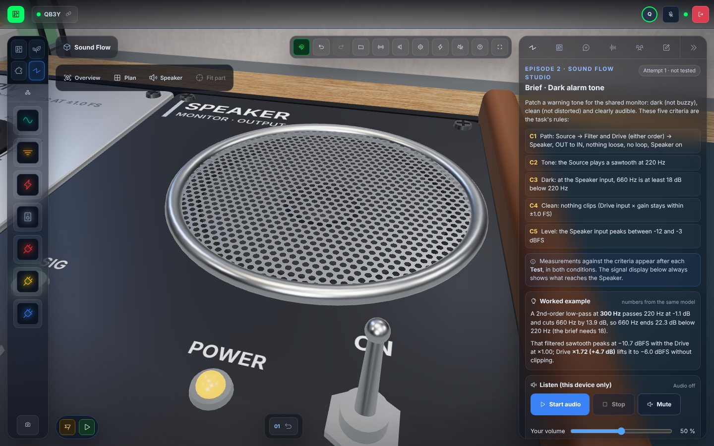 |

## Wrong patch, as built

The yellow cable runs Filter OUT → Drive IN, the blue one Drive OUT → Filter IN (a feedback loop), and the red one is plugged into Source OUT only. Nothing is repaired:
- the 3D jacks carry red rings;
- the diagram draws the loop hatched and silenced, and the loose end as a dotted plug;
- the notes say what each fault does;
- the text connection list says the same in words.

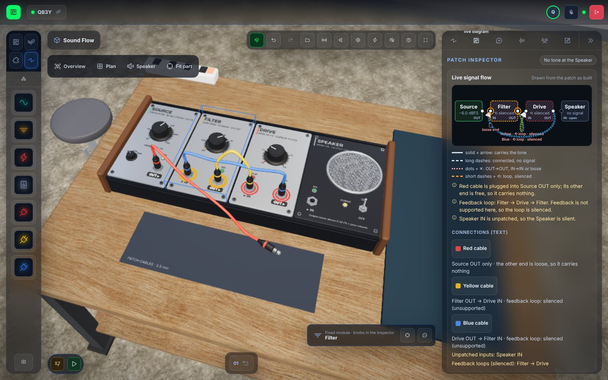

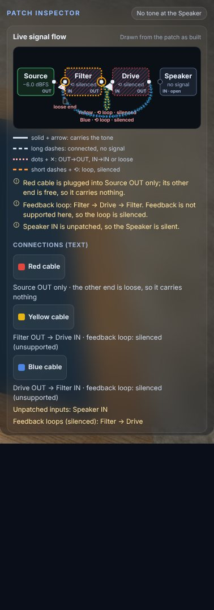

## Working: the brief met

The patch is Source → Filter → Drive → Speaker:
- sawtooth 220 Hz, cutoff 300 Hz, Drive ×1.70;
- the knobs were typed by keyboard in the Inspector and applied;
- the prediction was "meets", then *Test patch* was pressed, then *Start audio* was clicked.

The display shows the waveform rendered offline:
- peak −6.1 dBFS, RMS −10.6 dBFS, no clipping;
- the harmonics relative to the strongest;
- the live line from this tab's analysers (Speaker input −6.1 dBFS; output −24.2 dBFS at 50 % volume).

| Signal display | Test result |
|---|---|
| 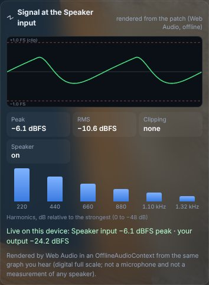 | 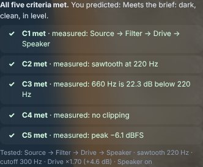 |

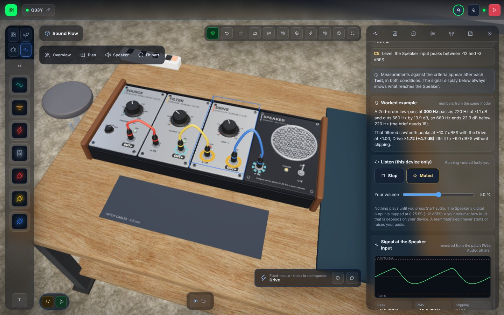

## Phone (390×844) and PF

| Phone, top | Phone, dock (wheel + Tab) | PF Studio panel (no worked example) |
|---|---|---|
| 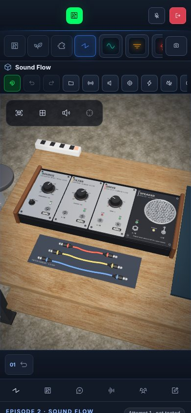 | 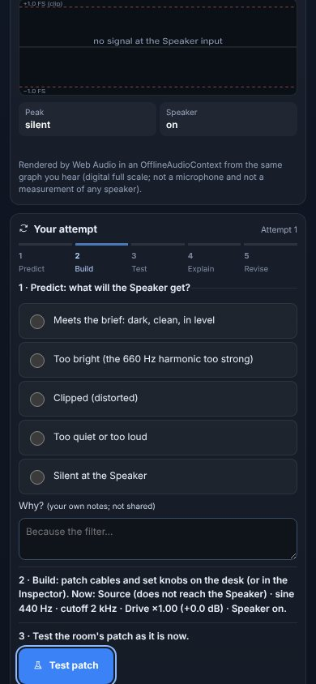 | 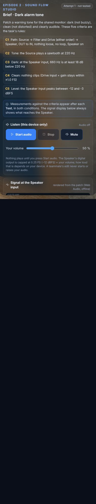 |

## Earlier capture runs (their images were replaced)

- **`1eaf1dd`**, 7/7 in 2,000 s: these files showed that app until `63a3421` was captured ([log](../../../qa/sound-flow/app-1eaf1dd/qa-sound.txt)).

- **`160f1f1`** passed the same 7/7 checks in 2,302 s. Its `08b` showed the inspector diagram clipped: the Speaker node was cut off at the dock's edge because the 640-unit SVG had a 360 px minimum width. The IN label also overlapped the node name. The diagram was fixed in `0df880c` (574 units, text sized in viewBox units, labels clear of the curves), and the shots above were taken again on `1eaf1dd`. That run's images were replaced.
- Development smoke captures were made before `160f1f1`. They fed the 3D fixes listed in the PR (jack bores, speaker cutout, wave-selector labels) and are not evidence of the final app.
