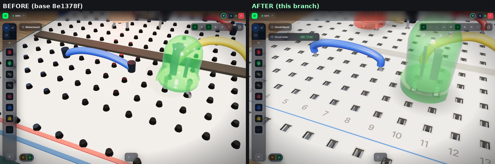
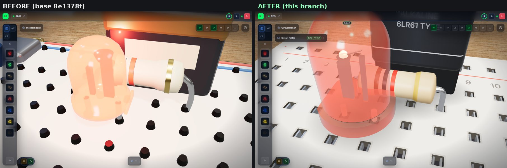
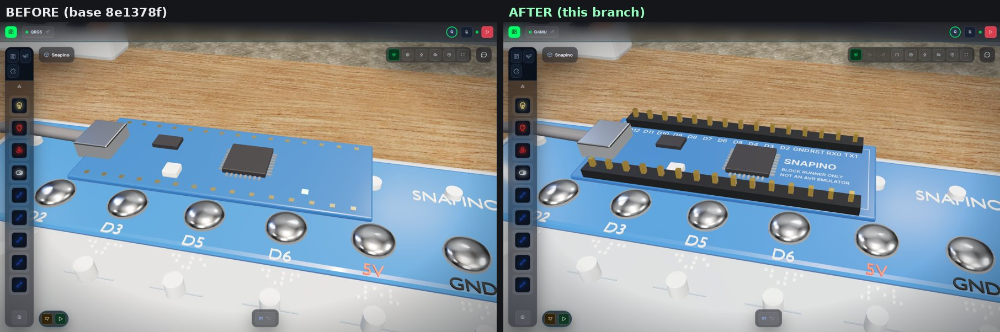

# Matched BEFORE/AFTER renders

Rendered with `scripts/qa-3d.mjs` (same camera positions and part placements in both builds) for commit `(the commit that adds docs/images/qa)`.
Software WebGL (SwiftShader) in headless Chromium; not checked on real GPUs, phones or a Quest headset.

### Overview, same camera and placements

### Red LED powered (about 7 mA through 1 kOhm)

### Green LED unpowered (unconnected strips)

### Occupied sockets, low close-up

### Jumper cable tip in a socket

### Breadboard sockets close-up

### LED and resistor close-up

### Snapino PCB close-up

### Laptop viewport 1180x760

### Phone viewport 390x844

## Renderer counters (draw calls / triangles / pixel ratio)

| View | BEFORE | AFTER |
|---|---|---|
| 1-overview | 508 / 79k / 1 | 271 / 41k / 1 |
| 2-overview-collapsed | 364 / 72k / 1 | 164 / 36k / 1 |
| 3-breadboard-close | 192 / 54k / 1 | 88 / 26k / 1 |
| 4-led-resistor-close | 133 / 40k / 1 | 64 / 19k / 1 |
| 5-cable-ends-close | 208 / 55k / 1 | 103 / 27k / 1 |
| 6-battery-close | 189 / 48k / 1 | 86 / 22k / 1 |
| 7-rails-close | 150 / 42k / 1 | 71 / 16k / 1 |
| 8-snapino-overview | 1220 / 96k / 1 | 1229 / 97k / 1 |
| 9-pcb-close | 448 / 30k / 1 | 457 / 30k / 1 |
| 10-laptop | 534 / 77k / 1 | 266 / 38k / 1 |
| 11-led-powered | 140 / 42k / 1 | 67 / 20k / 1 |
| 12-led-unpowered | 178 / 53k / 1 | 83 / 25k / 1 |
| 13-occupied-sockets | 160 / 42k / 1 | 76 / 19k / 1 |
| 14-cable-tip-macro | 157 / 43k / 1 | 69 / 18k / 1 |
| 15-meter-editor | — | 178 / 38k / 1 |
| 16-phone | 293 / 59k / 1 | 131 / 29k / 1 |

Raw numbers: [`stats.json`](stats.json).
